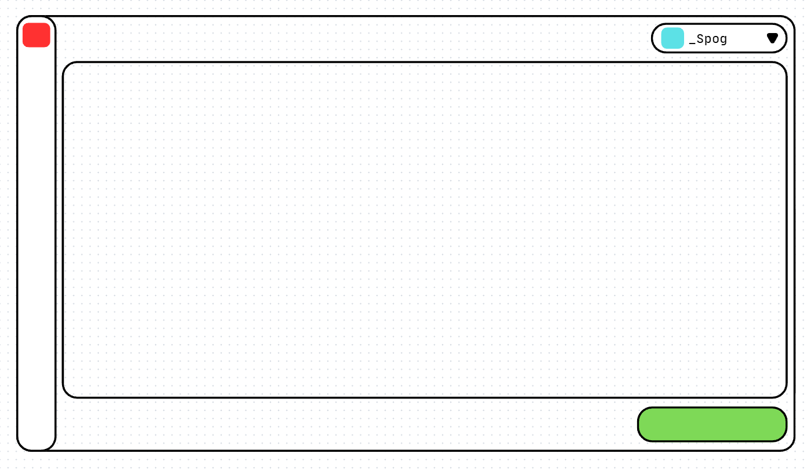

# Hermes Client app design

Design reference from the project owner. Add every screenshot, colour, font, layout and
behaviour detail they provide here. Reread before and during UI work.

## Global rules

- One consistent design across the whole app unless stated otherwise per screen.
- All text uses language keys; the build shows the key name until the owner supplies the text.
- Missing assets or instructions: use a marked placeholder, don't invent a design.

## Window

- Borderless, **fixed size** (can't be resized or maximised), **1200 x 707 px**, rounded corners
  **14 px** (`theme::WINDOW_RADIUS`; v1 was 30, owner asked for less rounded). Windows clips the
  window to its shape, and it is drawn with transparency so the **corners are smooth**.
- **Dark theme in cool slate tones** that sit with the blue accents (owner: the neutral greys
  didn't fit): background `#141C26`, panels `#1E2936`, dividers `#334355`, text `#EEF4FA` (lightened
  slightly on request from `#10171F` / `#19232F` / `#2E3D4E`). A light
  palette from an earlier trial is kept in `theme.rs` (switching is one line, `pub use light::*`).
- **Outlines**: 2 px. **Only the window and the sidebar** use the **diamond-like gradient** (Launch
  blue `#5AC8FA` to light blue `#D6F2FF` along the diagonal with faint facet bands). **Everything
  else** (content box, dropdowns) has a **subtle solid muted blue** `#2F566D` (made subtler on
  request, from `#3C7998`), brightening to the Launch blue when selected (owner: gradient on the sidebar and window only).
- **Shape scale** (`theme.rs`): window 14, panels 12, **controls (Launch, dropdowns) 14**, small
  controls 9. Every drawn icon uses a 2.5 px line.

## Layout

The v1 template (below) set the arrangement; the current build lays it out directly in
`theme::body_layout` (all gaps 14 px):

- **Sidebar**: full window height, **75 px** wide (50% wider on request), flush with the window's
  left, top and bottom edges. **Logo** (the owner's white wing) 48 px at its top.
- **Top bar** (`BAR_HEIGHT` 50 px, thicker on request): right of the sidebar, draggable except over
  its controls, with a **faint divider** (1 px, `#334355`) along its bottom edge. From the right:
  **close**, **minimise** (40 x 32 px buttons) and the **account switcher** (210 x 36 px, moved
  into the bar on request). No title.
- **Content box** (the home screen's right pane): the **right half** of the space between the
  sidebar and the right edge, from below the top bar down to the Launch button; the left half is
  left free for now. It lists the **pinned profiles** (see Home screen).
- **Launch button** bottom-right, 230 x 52 px. (The profile dropdown was removed on request.)

## Home screen

The only screen so far. Its right pane lists the **pinned profiles** as rows (56 px, glass tint,
solid outline, profile icon if it has one, then its name or `profile.unnamed`). **Clicking a row
selects that profile for Launch** (owner request; replaces the profile dropdown); the selected
row's outline is the bright Launch blue. Rows highlight on hover, shrink when pressed, and show
the hand cursor. Profiles are pinned with `"pinned": true` in their `profile.json` until the
launcher has a way to pin them; with nothing pinned the pane is empty.

## Sidebar

- **On hover it grows like the buttons and dropdowns** (same spring): it widens over the window to
  **310 px** and grows **6 px past the window's top, bottom and left edges** (a little less than the
  8 px overhang it once had). The window keeps transparent room for that, invisible while collapsed.
- While it opens, the **logo grows a little** (48 to 54 px) and **"Hermes" appears to its right in
  Pacifico**, its letters as tall as the logo, revealed as the sidebar widens and fading in.
- **Organic motion** (owner request): everything moves on the shared spring, layered so the
  sidebar reads as soft material: the **width leads**; the **growth past the window edges and the
  logo trail it** on their own springs (a beat behind); the **leading corners round out with
  speed** (up to +26 px radius) and settle back; **"Hermes" waits until the panel is past halfway**,
  then slides in 10 px while fading up, and **leaves first when closing**. Opens in about 0.5 s.
- **Leaving the window closes it immediately** (owner request), even while it's still opening: the
  one exception to finishing a move before reversing.
- **Predictive close** (owner request): while it's open, a fast pointer move (700+ px/s) whose
  path 0.12 s ahead leaves the sidebar starts closing it immediately, before the pointer actually
  exits. Fast moves that stay inside it don't, and neither do flicks that are more vertical than
  horizontal (owner request).
- **Reduced motion**: with Windows' "Show animations" turned off, every spring (sidebar, buttons,
  dropdowns) jumps straight to its end state and the outline's light band holds still.
- **A move always finishes before it can reverse**: once it starts opening it fully opens, once it
  starts closing it fully closes. Opening overshoots slightly; closing doesn't shrink below the
  collapsed size.
- Expanded it's a glass panel with a shadow and the selected outline.
- **Navigation rows**: **Home** under the logo and **Settings** at the very bottom (owner's icons,
  `assets/images/icon_home*.png`, `icon_settings*.png`). Icons **32 px**, labels 17 px (reduced from
  40/20 on request). Collapsed, only the icon shows, centred in the sidebar; as it opens the label
  appears beside it on the same slide-and-fade as the wordmark. **Hovering fills the icon** (outline
  and filled versions share one frame so the swap doesn't shift). Rows show the **hand cursor** and
  **shrink when pressed** (icon, label and selector together) like every other button.
- **Selector**: an **iOS-style frosted-glass ring**, **no fill** (owner request): a 4 px translucent
  cool-white edge that brightens where light catches it (top-left and bottom-right corners, top more
  than bottom), a fine bright inner rim and a faint dark outer rim for depth. Shown **only while
  hovered and the sidebar is open** (never when it's closed or closing; fades over 0.12 s). Fixed
  length: the full width of the open sidebar. The pages the rows open aren't designed yet, so
  clicking does nothing.
- **Launch button**: light blue `#5AC8FA` with dark text; working = muted blue (60% toward `PANEL`)
  with light text, and a thin blue progress track along the bottom while downloading;
  **while the game runs it becomes a red Stop button** (`#D7263D`, white text): Stop asks the game
  window to close (it saves and exits normally); pressing it again, or if the game has no window
  yet, ends the process; failed = outlined in `DANGER` (`#FF453A`) with `#FF8A84` text, click to
  retry, hover for details. Labels truncate with an ellipsis inside the button.
- **Hover / pressed**: white glass tints (`GLASS_HOVER`, `GLASS_PRESS`) on dropdowns, rows and window
  buttons; Launch brightens on hover and darkens when pressed; close turns red.
- **One spring for all motion** (`theme::spring`): button presses (shrink to 94%, spring back with
  about 14% overshoot), dropdowns opening and closing, and the sidebar all move on it at the same
  pace. The sidebar panel bounces a little less (about 7%), and its logo and text don't overshoot
  at all, so nothing inside it wobbles (owner request).
- **Selected outline**: when an element is selected (hovered, keyboard-focused or open; the
  sidebar while expanded) its outline eases to 3 px and a soft band of light travels slowly along
  the gradient (`theme::selectable_outline`).
- **Keyboard focus**: 2 px `#0A84FF` ring just outside the focused control (Tab moves focus,
  Enter/Space activates).
- **Cursor**: the pointer (hand) cursor stays on for the whole time the mouse is over a dropdown,
  in every state, with no flicker back to the arrow (owner request).
- Tooltips use the app palette (panel fill, outline, control radius).

## Text

- **All text in Afacad Flux Bold, 15% larger** than before (`theme::TEXT_SCALE` = 1.15, applied to
  every label and tooltip).
- **"Hermes" in the sidebar uses Pacifico** (only there).

## Profiles

- Data folder: `%APPDATA%\HermesClient\` (earlier builds used `hermes_client` and `.hermes`; the
  newest of those is moved over once on first run).
- Each profile is a folder `profiles\<name>\`, and that folder is also its Minecraft game folder
  (mods, config, saves, options). Downloaded game files (libraries, assets, Java) are shared.
- **Folder names come from the profile's name when it is created** (owner request; no ids):
  no name -> `Unnamed`; if taken -> `Unnamed (1)`, `Unnamed (2)`, ... using the lowest free number
  above 0. Named profiles work the same way (`PvP`, `PvP (1)`). Characters Windows forbids become
  `_`. The folder name stays fixed afterwards (renaming isn't designed yet).
- Inside it, `profile.json` holds the profile's details: `name` (optional), `icon` (file name of a
  PNG in the same folder, optional), `created` (orders the list), `pinned` (optional: listed on the home screen). New details get
  added here.
- The selected profile is remembered in `launcher.json` in the data folder.
- Launch starts the profile selected in the home screen's pinned list.
- **Creating** profiles from the launcher was removed for now: the owner will add it later, with
  the name picked by the user. No design yet for creating, renaming or deleting profiles.

## Dropdowns

- Dropdowns (the account switcher) **expand in place into the list of options**.
- The **dropdown arrow morphs into a check mark** that marks the selected option.
- Look and motion **inspired by Apple iOS "Liquid Glass"**: translucent glass panel, soft light
  edge, springy expand. (egui can't blur what is behind a window region, so the glass is
  approximated with translucency, highlight and shadow.)

## Language keys

Owner fills in the text after reviewing where each key appears in the build.
Files: `assets/lang/<code>.json` (Minecraft Java style). Empty value = the key itself is shown.
Keys have no `launcher.` prefix (owner request).

| Key | Where it appears | Text |
|---|---|---|
| `play` | Launch button, idle | Launch |
| `status.metadata` | Launch button while reading game metadata | |
| `status.checking` | Launch button while checking game files | Checking... |
| `status.downloading` | Launch button while downloading (`%1$s` done, `%2$s` total) | |
| `status.preparing_java` | Launch button while building the Java class cache (first launch) | |
| `status.starting` | Launch button while starting Minecraft | |
| `status.stop` | Red Stop button shown in place of Launch while the game runs; closes the game | Stop |
| `status.failed` | Launch button after a failed launch | |
| `status.failed.details` | Tooltip when hovering a failed Launch button (`%s` = technical error) | |
| `window.close` | Close button in the top bar (screen-reader name, not drawn) | |
| `window.minimise` | Minimise button in the top bar (screen-reader name, not drawn) | |
| `profile.unnamed` | Home screen pinned list, a profile without a name | Unnamed Profile |
| `sidebar.home` | Sidebar Home row label (shown when the sidebar is open) | Home |
| `sidebar.settings` | Sidebar Settings row label (shown when the sidebar is open) | Settings |

## Assets

- **Fonts** (both SIL Open Font License; the licence files must ship with them):
  - **Afacad Flux Bold** (`assets/fonts/AfacadFlux-Bold.ttf`, `OFL-AfacadFlux.txt`): all text.
  - **Pacifico** (`assets/fonts/Pacifico-Regular.ttf`, `OFL-Pacifico.txt`): the sidebar's "Hermes".
  - egui's bundled fonts were removed. Afacad Flux covers Latin scripts only: a language in
    Cyrillic, Greek, CJK or Arabic needs a fallback font for that script.
- **Logo**: the owner's white wing on transparent (`assets/images/logo.png`, cropped and resized to
  256 px from the supplied 1024 px image; drawn with mipmaps so it stays smooth when small).
- **App icon** (taskbar, window, Explorer): the white wing on a **dark blue circle** (`#0E2A4A` with a
  thin `#2A5A86` rim) so it stays visible on the taskbar; the wing fills 74% of the circle (enlarged
  on request). `assets/images/app_icon.png`
  sets the window/taskbar icon; `app_icon.ico` (16-256 px) is embedded in the exe by `build.rs`.
- Account head: none yet. Placeholder blue square; real skin heads need online accounts.
